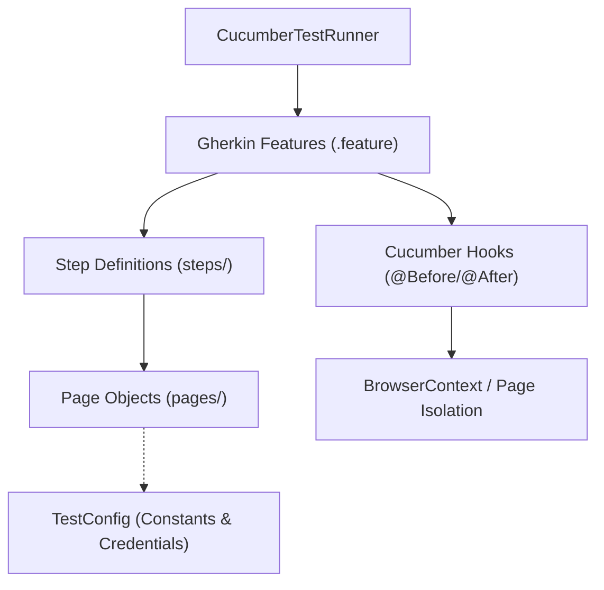

# Requirements

### Overview & Goals
Extend `tasks/plan.md`, `tasks/todo.md`, and `README.md` to adopt a **Cucumber BDD** architecture integrated with Playwright Java, JUnit 5, and Page Object Model (POM). Adding explicit BDD specifications, File Strategy, and Test Strategy maximizes test maintainability, stakeholder visibility, and diagnostic speed while minimizing flaky failures and maintenance overhead.

### Scope
- **In Scope:**
  - Defining Cucumber BDD architecture with `.feature` files, step definitions, and runner.
  - Defining the directory and package organization (File Strategy) separating Page Objects, step definitions, hooks, context, and feature files.
  - Defining scenario lifecycle, locator precedence, synchronization, and assertion guidelines (Test Strategy).
  - Updating `tasks/plan.md`, `tasks/todo.md`, and `README.md`.
- **Out of Scope:**
  - Modifying application source code outside test and documentation files.

### Functional Requirements
- `tasks/plan.md` must contain a dedicated **Cucumber BDD** plan, **File Strategy**, and **Test Strategy** sections.
- `tasks/todo.md` must reflect actionable tasks for Cucumber BDD configuration, feature writing, and step definitions.
- `README.md` must detail Cucumber BDD commands, feature directory structure, and execution instructions.

# Technical Design

### Key Decisions
1. **Cucumber BDD with Gherkin Specifications**: Formulate test scenarios as declarative Given-When-Then features under `src/test/resources/features/` to maximize readability and living documentation utility.
2. **Page Object Model (POM) Integration**: Step definitions interact exclusively through Page Objects in `pages/`, avoiding raw selector logic in steps and ensuring DRY test design.
3. **Scenario-Level BrowserContext Isolation**: Initialize fresh `BrowserContext` and `Page` instances for each scenario in Cucumber `@Before` / `@After` hooks.
4. **Web-First Assertions & Semantic Locators**: Prioritize user-facing locators (`getByRole`, `getByPlaceholder`, `getByText`) and stable `data-test` attributes with Playwright `assertThat()` auto-waiting.

### File Strategy
```
src/test/
├── java/com/almezi/saucedemocom/
│   ├── config/
│   │   └── TestConfig.java             # Environment URLs, test credentials, and global flags
│   ├── context/
│   │   └── TestContext.java            # Scenario state container and Playwright instance holder
│   ├── hooks/
│   │   └── Hooks.java                  # Cucumber @Before and @After lifecycle hooks (context setup/teardown)
│   ├── pages/
│   │   ├── LoginPage.java              # Login page actions and locators
│   │   ├── InventoryPage.java          # Products listing and cart navigation
│   │   ├── CartPage.java               # Shopping cart verification
│   │   ├── CheckoutStepOnePage.java    # Customer details form
│   │   ├── CheckoutStepTwoPage.java    # Order overview and calculations
│   │   └── CheckoutCompletePage.java   # Order dispatch confirmation
│   ├── steps/
│   │   ├── LoginSteps.java             # Step definitions for authentication flows
│   │   ├── InventorySteps.java         # Step definitions for catalog and cart additions
│   │   ├── CartSteps.java              # Step definitions for cart verification
│   │   └── CheckoutSteps.java          # Step definitions for customer info, overview, and completion
│   └── runners/
│       └── CucumberTestRunner.java     # Cucumber JUnit Platform Suite runner configuration
└── resources/
    ├── cucumber.properties             # Cucumber output and plugin configuration
    └── features/
        ├── login.feature               # Gherkin scenarios for login (success, locked-out)
        └── checkout.feature            # Gherkin scenario for end-to-end Onesie checkout
```

### Test Strategy
1. **Lifecycle & Isolation**:
   - `Playwright` and `Browser` instances managed at suite level.
   - Individual `BrowserContext` and `Page` instances created per scenario (`@Before`) and closed cleanly (`@After`).
2. **Locator Hierarchy**:
   - Level 1: Role and accessible names (`page.getByRole(AriaRole.BUTTON, new Page.GetByRoleOptions().setName("Login"))`).
   - Level 2: Label / Placeholder / Text (`page.getByPlaceholder("Username")`).
   - Level 3: Stable test identifiers (`page.locator("[data-test='shopping-cart-badge']")`).
   - Disallowed: Dynamic CSS class names, absolute XPath paths, index-dependent position locators.
3. **Assertions & Synchronization**:
   - Playwright web-first assertions (`assertThat`).
   - Built-in retries and auto-waiting; reject explicit thread pauses.
4. **Diagnostics & Failure Capture**:
   - Capture screenshots and attach to Cucumber scenario report on failure.

### Architecture Diagram


# Delivery Steps

### ✓ Step 1: Define File Strategy and Test Strategy in Plan
`tasks/plan.md` is updated with comprehensive Cucumber BDD architecture, File Strategy, and Test Strategy sections to govern the test automation design.

### ✓ Step 2: Align Task Breakdown with Test and File Strategies
`tasks/todo.md` and `README.md` are updated to reflect Cucumber BDD task items, feature organization, and execution commands.