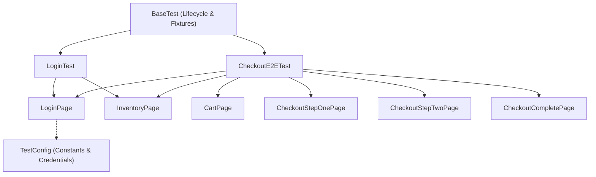

# Requirements

### Overview & Goals
Extend `tasks/plan.md` to specify both a **File Strategy** and a **Test Strategy** for the SauceDemo Playwright Java test suite. Adding explicit architectural strategies maximizes test maintainability, execution reliability, and diagnostic speed while minimizing flaky failures and maintenance overhead.

### Scope
- **In Scope:**
  - Defining the directory and package organization (File Strategy) separating Page Objects, configuration, and test suites.
  - Defining the test execution lifecycle, locator precedence, synchronization, and assertion guidelines (Test Strategy).
  - Updating `tasks/plan.md` and synchronizing with `tasks/todo.md`.
- **Out of Scope:**
  - Introducing additional external test frameworks or third-party assertion libraries beyond JUnit 5 and Playwright Java.
  - Modifying application source code outside test and task planning files.

### Functional Requirements
- `tasks/plan.md` must contain a dedicated **File Strategy** section detailing class placement, package organization, and separation of concerns.
- `tasks/plan.md` must contain a dedicated **Test Strategy** section detailing browser context lifecycle, locator precedence, auto-waiting, and error diagnosis.
- The task list and acceptance criteria must stay consistent with the added strategies.


# Technical Design

### Current Implementation
- `pom.xml` configures Playwright Java 1.47.0 and JUnit 5.10.3.
- `src/test/java/com/almezi/saucedemocom/SmokeTest.java` currently contains a single monolithic test creating and destroying Playwright instances inline.
- `tasks/plan.md` details scenarios and risks but lacks structured file architecture and locator/synchronization guidelines.

### Key Decisions
1. **Page Object Model (POM) with Component Encapsulation**: Encapsulate locators and page interactions within dedicated Page classes (`pages/`) to minimize locator duplication and reduce refactoring costs when UI structure evolves.
2. **BrowserContext Isolation per Test**: Initialize a fresh `BrowserContext` and `Page` for each `@Test` method using JUnit `@BeforeEach` and `@AfterEach` lifecycle hooks, preventing test pollution and ensuring deterministic outcomes.
3. **Web-First Assertions & Semantic Locators**: Prioritize user-facing locators (`getByRole`, `getByLabel`, `getByText`) and stable `data-test` attributes with Playwright `assertThat()` auto-waiting, strictly avoiding hardcoded sleeps (`Thread.sleep`) or brittle XPath selectors.

### File Strategy
```
src/test/java/com/almezi/saucedemocom/
├── base/
│   └── BaseTest.java             # Browser/Playwright lifecycle hooks and fixture management
├── config/
│   └── TestConfig.java           # Centralized environment constants (base URL, demo credentials)
├── pages/
│   ├── LoginPage.java            # Login page interactions and locators
│   ├── InventoryPage.java        # Inventory/product listing and cart badge interactions
│   ├── CartPage.java             # Shopping cart item verification and navigation
│   ├── CheckoutStepOnePage.java  # Customer information form handling
│   ├── CheckoutStepTwoPage.java  # Order overview and item verification
│   └── CheckoutCompletePage.java # Order completion confirmation and assertions
└── tests/
    ├── LoginTest.java            # Atomic login tests (success and validation)
    └── CheckoutE2ETest.java       # End-to-end checkout workflow (Sauce Labs Onesie)
```

### Test Strategy
1. **Lifecycle & Isolation**:
   - `Playwright` and `Browser` instances managed at class or suite level.
   - Individual `BrowserContext` and `Page` instances created per test (`@BeforeEach`) and closed cleanly (`@AfterEach`) to guarantee zero state leakage.
2. **Locator Hierarchy**:
   - Level 1: Role and accessible names (`page.getByRole(AriaRole.BUTTON, new Page.GetByRoleOptions().setName("Login"))`).
   - Level 2: Label / Placeholder / Text (`page.getByPlaceholder("Username")`).
   - Level 3: Stable test identifiers (`page.locator("[data-test='shopping-cart-badge']")`).
   - Disallowed: Dynamic CSS class names, absolute XPath paths, index-dependent position locators.
3. **Assertions & Synchronization**:
   - Utilize Playwright's `com.microsoft.playwright.assertions.PlaywrightAssertions.assertThat`.
   - Leverage built-in retries and auto-waiting; reject explicit thread pauses.
4. **Diagnostics & Failure Capture**:
   - Capture page screenshots or Playwright traces on test failure to accelerate root-cause triage.

### Architecture Diagram



# Testing

### Validation Approach
Verify that the updated `tasks/plan.md` and associated task descriptions provide complete, actionable instructions that allow any engineer or agent to implement the test suite deterministically.

### Key Scenarios
1. **Plan Completeness**:
   - Verify `tasks/plan.md` includes explicit sections for File Strategy, Test Strategy, Lifecycle, Locator Hierarchy, and Synchronization.
2. **Consistency**:
   - Ensure the task list in `tasks/plan.md` and `tasks/todo.md` directly maps to the proposed Page Object file layout and test architecture.
3. **Executable Compliance**:
   - Verify that all guidelines align with standard Playwright Java and JUnit 5 best practices, runnable via `mvn test`.


# Delivery Steps

###   Step 1: Define File Strategy and Test Strategy in Plan
`tasks/plan.md` is updated with comprehensive File Strategy and Test Strategy sections to govern the test automation architecture.

- Define the File Strategy: Page Object Model (POM) directory layout (`pages/`, `config/`, test suites), naming conventions, and separation of UI locators from test logic.
- Define the Test Strategy: Context isolation per test, Playwright web-first assertions, auto-waiting policies, locator priority rules, and diagnostic artifact handling (screenshots/traces on failure).
- Ensure alignment between existing task breakdown and the newly added architectural strategies.

###   Step 2: Align Task Breakdown with Test and File Strategies
`tasks/todo.md` is updated to reflect task items corresponding to the structural foundation and strategy implementation.

- Add tasks for establishing base test fixtures and Page Object structure in `src/test/java/com/almezi/saucedemocom/`.
- Ensure each test task adheres to locator hierarchy and web-first assertion standards defined in the test strategy.